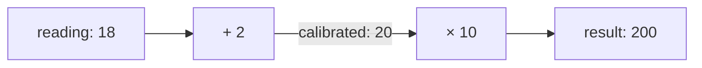

# Arithmetic

To combine graph values, use arithmetic expressions. This calculation adds a
calibration offset of `2` to a reading of `18`, then multiplies the result by
`10` to express the temperature in tenths of a degree.

## Expressions and named results

::::::{tab-set}
:sync-group: language

:::::{tab-item} Python
:sync: python

```python
from bg import graph, test_graph
from bg.operators import const_


@graph
def display_temperature() -> int:
    reading = const_(18)
    calibrated = reading + 2
    return calibrated * 10


print(test_graph(display_temperature))
```

Output:

```text
[200]
```

:::::

:::::{tab-item} C++
:sync: cpp

::::{tab-set}

:::{tab-item} Code

```cpp
#include <bg/library.hpp>
#include <bg/testing/test_graph.hpp>

#include <iostream>

using namespace bg;
using namespace bg::testing;
using namespace bg::operators;

auto display_temperature() {
    const auto reading = const_(18);
    const auto calibrated = reading + 2;
    return calibrated * 10;
}

int main() {
    const auto result = test_graph(display_temperature);
    std::cout << std::boolalpha << result.equals({200}) << '\n';
}
```

Output:

```text
true
```

:::

:::{tab-item} Build and run

This example uses the CMake project and `bg::library` link target from
[A first BG program](getting-started.md#write-and-run-the-example), with the
code saved as `first_graph.cpp`. The build and run commands are the same.
:::
::::

:::::
::::::

`reading` names the fixed input. `calibrated` names the addition's output;
using it in `calibrated * 10` connects that output to the multiplication.
The graph returns `200`.

| Expression | Operation |
| --- | --- |
| `reading + 2` | Add an offset. |
| `reading - 2` | Subtract an offset. |
| `calibrated * 10` | Scale a result. |

Arithmetic expressions use the language's usual precedence and parentheses.
For example, `(reading + 2) * 10` describes the same calculation as the two
expressions above. An expression involving a graph value connects a calculation;
BG performs that calculation when the graph runs.

## Dependencies between calculations



BG evaluates the addition before the multiplication because the multiplication
uses its output. A named result can also be used in several expressions.

For a calculation used in several places,
[Graph functions](connect-calculations.md) covers parameters and calls.

[Arithmetic reference](../reference/library-numeric.md) specifies the full contract.
