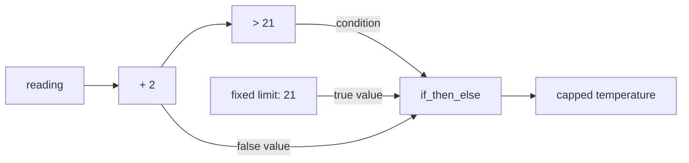

# Conditionals

To choose a result, first determine when the condition is available:

| Condition | When the choice is made | Graph code |
| --- | --- | --- |
| A fixed setting supplied as a scalar argument | During graph construction | Ordinary `if` |
| A comparison or Boolean input that changes during a run | During evaluation | `if_then_else` |

A graph function runs while BG constructs connections. At that point,
`reading + 2` and `calibrated > 21` identify outputs of calculations. Their current
values become available during evaluation. An ordinary `if` needs a Boolean
value immediately, while the graph function is running.

These examples use calibrated temperatures in degrees, before the display
scaling in [Arithmetic](arithmetic.md).

## Choose a result as the condition changes

To cap a calibrated temperature at `21`, use
`if_then_else(condition, true_value, false_value)`. A true condition selects
`21`; a false condition selects the calibrated temperature. Both choices must
be graph values, so `const_(21)` supplies the fixed limit:

::::::{tab-set}
:sync-group: language

:::::{tab-item} Python
:sync: python

```python
from bg import graph, test_graph
from bg.operators import const_, if_then_else


@graph
def capped_temperature(reading: int) -> int:
    calibrated = reading + 2
    too_hot = calibrated > 21
    return if_then_else(too_hot, const_(21), calibrated)


print(test_graph(capped_temperature, [18, 20, 19]))
```

Output:

```text
[20, 21, 21]
```
:::::

:::::{tab-item} C++
:sync: cpp

::::{tab-set}

:::{tab-item} Code

```cpp
#include <bg/library.hpp>
#include <bg/testing/test_graph.hpp>

#include <iostream>

using namespace bg;
using namespace bg::testing;
using namespace bg::operators;

auto capped_temperature(wp<TS<i64>> reading) {
    const auto calibrated = reading + 2;
    const auto too_hot = calibrated > 21;
    return if_then_else(too_hot, const_(21), calibrated);
}

int main() {
    const auto result = test_graph(capped_temperature, {18, 20, 19});
    std::cout << std::boolalpha << result.equals({20, 21, 21}) << '\n';
}
```

Output:

```text
true
```
:::

:::{tab-item} Build and run

The [first program's CMake project](getting-started.md#write-and-run-the-example)
also builds this example. The file is `first_graph.cpp`, linked to `bg::library`.
:::
::::
:::::
::::::

`too_hot` identifies a Boolean output. The `>` expression creates the comparison;
`if_then_else` connects it to the choice of result. Both become part of the graph
constructed by this function. BG evaluates the comparison and selects the result
as readings arrive, without calling the graph function again.

| Reading update | Calibrated temperature | `too_hot` | Selected value |
| --- | --- | --- | --- |
| 18 | 20 | False | Calibrated temperature: 20 |
| 20 | 22 | True | Fixed limit: 21 |
| 19 | 21 | False | Calibrated temperature: 21 |

Graph comparisons also support `<`, `<=`, `==`, `!=`, and `>=`.



## Why an ordinary `if` cannot read this condition

The following fragment attempts to test a graph connection during construction.
It cannot select according to the current temperature:

::::::{tab-set}
:sync-group: language

:::::{tab-item} Python
:sync: python

```python
if calibrated > 21:
    return 21
return calibrated
```

Python raises `TypeError` with the message “A wiring point has no Python truth
value”. A Python conditional expression such as `21 if too_hot else calibrated`
requires the same truth conversion.
:::::

:::::{tab-item} C++
:sync: cpp

```cpp
if (calibrated > 21) {
    return 21;
}
return calibrated;
```

The comparison returns a `wp<>`, which does not convert to a native `bool`.
C++ rejects the `if` condition. Its `?:` conditional expression also requires a
native Boolean condition.
:::::
::::::

Moving the comparison into a variable does not change this: `too_hot` remains
a connection. The value type `bool` describes what the comparison produces
during evaluation.

## Use `if` with a fixed setting

When a setting is a scalar argument, an ordinary `if` can use it while constructing
the graph. Here, the caller fixes `apply_offset` to true:

::::::{tab-set}
:sync-group: language

:::::{tab-item} Python
:sync: python

```python
from bg import graph, test_graph


@graph
def calibrated_temperature(reading: int, apply_offset: bool) -> int:
    offset = 0
    if apply_offset:
        offset = 2
    return reading + offset


@graph
def reported_temperature(reading: int) -> int:
    return calibrated_temperature(reading, True)


print(test_graph(reported_temperature, [18, 20, 19]))
```

Output:

```text
[20, 22, 21]
```
:::::

:::::{tab-item} C++
:sync: cpp

```cpp
#include <bg/library.hpp>
#include <bg/testing/test_graph.hpp>

#include <iostream>

using namespace bg;
using namespace bg::testing;

auto calibrated_temperature(wp<TS<i64>> reading, bool apply_offset) {
    auto offset = 0;
    if (apply_offset) {
        offset = 2;
    }
    return reading + offset;
}

auto reported_temperature(wp<TS<i64>> reading) {
    return calibrated_temperature(reading, true);
}

int main() {
    const auto result = test_graph(reported_temperature, {18, 20, 19});
    std::cout << std::boolalpha << result.equals({20, 22, 21}) << '\n';
}
```

Output:

```text
true
```
:::::
::::::

The `if` chooses the offset during construction. This run uses `2` for every
reading. Passing false in the inner call would choose `0` for the entire run.

`apply_offset` is fixed because the caller supplies an ordinary Boolean value.
A Boolean update sequence passed through `test_graph` would instead provide a
changing input; that requires `if_then_else` as in the first example. In Python,
the plain `bool` annotation can accept either form, so the call determines
whether the graph function receives a scalar or a connection.

## Combine conditions

To require a temperature to be both at least `20` and at most `21`, combine
two comparisons:

::::::{tab-set}
:sync-group: language

:::::{tab-item} Python
:sync: python

```python
from bg import graph, test_graph
from bg.operators import and_


@graph
def temperature_in_range(reading: int) -> bool:
    calibrated = reading + 2
    return and_(calibrated >= 20, calibrated <= 21)


print(test_graph(temperature_in_range, [17, 18, 19, 20]))
```

Output:

```text
[False, True, True, False]
```
:::::

:::::{tab-item} C++
:sync: cpp

```cpp
#include <bg/library.hpp>
#include <bg/testing/test_graph.hpp>

#include <iostream>

using namespace bg;
using namespace bg::testing;

auto temperature_in_range(wp<TS<i64>> reading) {
    const auto calibrated = reading + 2;
    return (calibrated >= 20) && (calibrated <= 21);
}

int main() {
    const auto result = test_graph(temperature_in_range, {17, 18, 19, 20});
    std::cout << std::boolalpha << result.equals({false, true, true, false}) << '\n';
}
```

Output:

```text
true
```
:::::
::::::

| Meaning | Python, imported from `bg.operators` | C++ |
| --- | --- | --- |
| Both conditions are true | `and_(left, right)` | `left && right` |
| Either condition is true | `or_(left, right)` | `left || right` |
| Reverse a condition | `not_(condition)` | `!condition` |

Python's `and`, `or`, `not`, and chained comparisons such as
`20 <= calibrated <= 21` require a native truth value. The named graph operations
connect Boolean calculations instead.

Boolean graph operations evaluate both operand expressions during construction.
They have no short-circuit behavior. A binary Boolean calculation waits for both
inputs to have current values, even when one value would determine the result
in an ordinary language expression.

## Choose among several outcomes

For an `if` / `elif` / `else` choice that changes during a run, nest
`if_then_else` calls. This example reports `-1` below the range, `0` within it,
and `1` above it:

::::::{tab-set}
:sync-group: language

:::::{tab-item} Python
:sync: python

```python
from bg import graph, test_graph
from bg.operators import const_, if_then_else


@graph
def temperature_band(reading: int) -> int:
    calibrated = reading + 2
    return if_then_else(
        calibrated < 20,
        const_(-1),
        if_then_else(calibrated > 21, const_(1), const_(0)),
    )


print(test_graph(temperature_band, [17, 18, 20, 17]))
```

Output:

```text
[-1, 0, 1, -1]
```
:::::

:::::{tab-item} C++
:sync: cpp

```cpp
#include <bg/library.hpp>
#include <bg/testing/test_graph.hpp>

#include <iostream>

using namespace bg;
using namespace bg::testing;
using namespace bg::operators;

auto temperature_band(wp<TS<i64>> reading) {
    const auto calibrated = reading + 2;
    return if_then_else(
        calibrated < 20,
        const_(-1),
        if_then_else(calibrated > 21, const_(1), const_(0)));
}

int main() {
    const auto result = test_graph(temperature_band, {17, 18, 20, 17});
    std::cout << std::boolalpha << result.equals({-1, 0, 1, -1}) << '\n';
}
```

Output:

```text
true
```
:::::
::::::

The outer choice selects `-1` when the calibrated temperature is below `20`.
Otherwise, its false input supplies the inner choice between `1` and `0`.
The outer condition has priority, just as the first condition does in an
`if` / `elif` / `else` statement.

## Which updates reach the result

`if_then_else` follows the selected input:

- Changing the selection exposes the selected input's current value immediately,
  even if that input does not update at the same time.
- Updates from the selected input reach the result. Updates from the other input
  do not.
- A repeated condition value keeps the same selection and produces no output
  update by itself.

In `capped_temperature`, the fixed limit stays at `21`. While it remains selected,
additional above-limit readings produce no output update. Selecting `calibrated`
again publishes its current value, even if that value is also `21`.

The condition and selected input need current values for the result to have a
current value. The other input can still be waiting for its first value.

## Selection and execution

Both argument expressions passed to `if_then_else` are evaluated during graph
construction, including any graph function calls. Their calculations remain
connected and can run when their inputs update, including while unselected.

For example, selecting between two calculations does not protect an unselected
calculation from division by zero. A node can use ordinary language `if` on its
current input values when an operation must run only in one case. Node definitions
are introduced later. Starting and stopping a selected graph is the separate
purpose of `switch_`, covered after stateful graphs.
