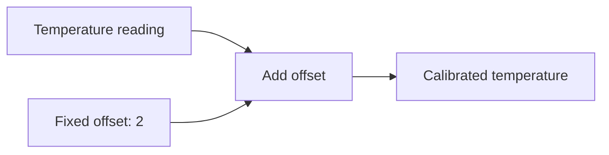

# Introduction to BG

BG lets you connect calculations whose inputs change over time. You describe
how outputs depend on inputs. BG evaluates the calculations as updates arrive.

For example, a temperature reading can feed a calibration calculation. When a
new reading arrives, BG calculates the calibrated temperature. You can connect
that result to further calculations and reuse it in several places.

The connections form a computation graph. Each node performs a calculation;
its inputs connect it to the values it uses. BG uses those connections to
evaluate calculations in dependency order.

Use BG when derived results need to follow changing inputs. Examples include
sensor calculations, changing prices, and results maintained separately for
many items.

## Start here

Every example has Python and C++ versions. Choose either language and follow
it throughout the guide. You need basic knowledge of functions and types in
that language. You do not need previous experience with graphs.

[Install BG](installation.md), then follow these lessons:

1. [Your first graph](getting-started.md): write a calculation and run it with
   a sequence of inputs.
2. [Values that change](changing-values.md): skip an update and connect inputs
   that update independently.

The examples begin with plain types such as `int`. Each chapter introduces
additional syntax when its examples need it.
