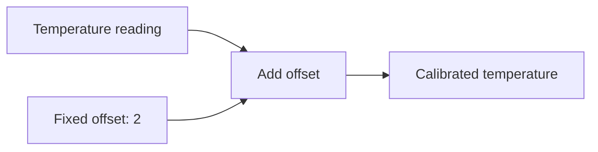

# Introduction to BG

BG lets you connect calculations whose inputs change over time. You describe
how outputs depend on inputs. BG evaluates the calculations as updates arrive.

For example, a temperature reading can feed a calibration calculation. When a
new reading arrives, BG calculates the calibrated temperature. You can connect
that result to further calculations and reuse it in several places.

The connections form a computation graph. Each node performs a calculation;
its inputs connect it to the values it uses. BG uses those connections to
evaluate calculations in dependency order.

Use BG when derived results need to follow changing inputs. Examples include
sensor calculations, changing prices, and results maintained separately for
many items.

## Start here

Every example has Python and C++ versions. The language tabs remember your
choice across pages. The guide assumes basic knowledge of functions and types
in either language and introduces graph concepts from the beginning.

### Getting started

- [Installation](installation.md): set up BG for Python or C++.
- [A first BG program](getting-started.md): imports, declarations, a fixed result,
  and a test run.

### Graph basics

- [Arithmetic](arithmetic.md): combine values with expressions and name results.
- [Graph functions](connect-calculations.md): give a calculation parameters and
  call it from another graph.
- [Values that change](changing-values.md): supply input sequences to `test_graph`,
  combine fixed arguments with changing inputs, and handle skipped or simultaneous updates.
- [Conditionals](conditions.md): choose during construction or evaluation,
  combine conditions, handle several outcomes, and follow updates from the selected input.

### Working with updates

- [Suppress repeated values](dedup.md): publish changes with `dedup` and choose
  where to suppress repeated updates.
- [Forward updates conditionally](filter.md): forward readings while enabled
  and preserve the last output while forwarding is closed.
- [Read a value when signalled](sample.md): publish the latest value on each
  signal update.
- [Count and remember updates](count-and-lag.md): count readings and read the
  preceding calibrated value.
- [Running calculations](running-calculations.md): maintain totals and means
  across successive readings.

The examples begin with plain types such as `int`. Each chapter introduces
additional syntax when its examples need it.
