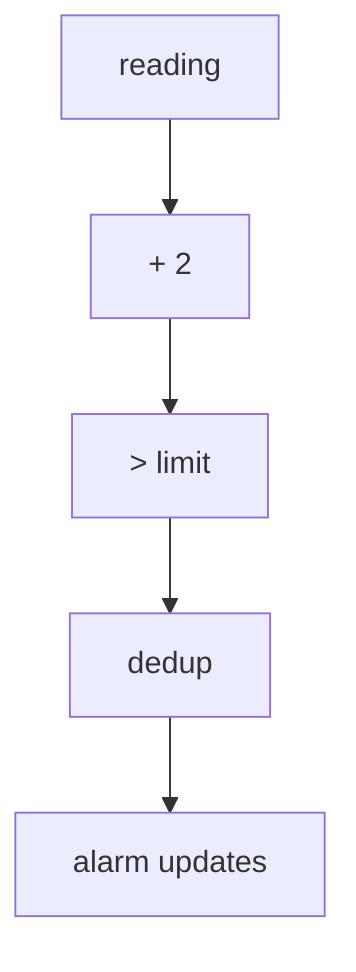

# Temperature alarm changes

To notify an application when a sensor enters or leaves an alarm condition,
compare its calibrated reading with a fixed limit and deduplicate the Boolean
result. This publishes the initial alarm state and each transition.

Prerequisites: [Graph functions](../guide/graphs/composition.md#graph-functions),
[comparisons](../guide/graphs/conditionals.md), [deduplication](../guide/graphs/updates.md#repeated-values).

<!-- runnable-example -->
::::::{tab-set}
:sync-group: language

:::::{tab-item} Python
:sync: python

```python
from bg import graph, run_graph
from bg.operators import dedup

@graph
def temperature_alarm(reading: int, limit: int) -> bool:
    calibrated = reading + 2
    return dedup(calibrated > limit)

@graph
def monitor(reading: int) -> bool:
    return temperature_alarm(reading, 21)

print(run_graph(monitor, [18, 19, 20, 22, 19, 18]))
```

Output:

```text
[False, None, True, None, False, None]
```
:::::

:::::{tab-item} C++
:sync: cpp

::::{tab-set}

:::{tab-item} Code

```cpp
#include <bg/library.hpp>
#include <bg/run_graph.hpp>
#include <iostream>

using namespace bg;
using namespace bg::operators;
using namespace literal;

auto temperature_alarm(wp<TS<i64>> reading, i64 limit) {
    const auto calibrated = reading + 2;
    return dedup(calibrated > limit);
}

auto monitor(wp<TS<i64>> reading) {
    return temperature_alarm(reading, 21);
}

int main() {
    const auto result = run_graph(monitor, {18, 19, 20, 22, 19, 18});
    std::cout << std::boolalpha << result.equals({false, SKIP, true, SKIP, false, SKIP}) << '\n';
}
```

Output:

```text
true
```
:::

:::{tab-item} Build and run

The [C++ example project](../guide/installation.md#c-example-project)
builds this example as `main.cpp`, linked to `bg::library`.
:::
::::
:::::
::::::

| Reading | Calibrated value | Alarm state | Published update |
| --- | --- | --- | --- |
| 18 | 20 | False | False |
| 19 | 21 | False | No update |
| 20 | 22 | True | True |
| 22 | 24 | True | No update |
| 19 | 21 | False | False |
| 18 | 20 | False | No update |

The limit is a scalar argument: each monitor can use a different fixed limit.
Deduplication follows the comparison because the application needs changes in
alarm state. Different above-limit readings can still mean the same alarm state.
The comparison uses `>`; a calibrated value equal to the limit clears the alarm.



A [sink](../guide/execution/running.md) can send the Boolean updates to the application.
For a display refreshed on demand, use [requested summaries](requested-summary.md).
[Download the examples](examples.md) to run them outside this page.
