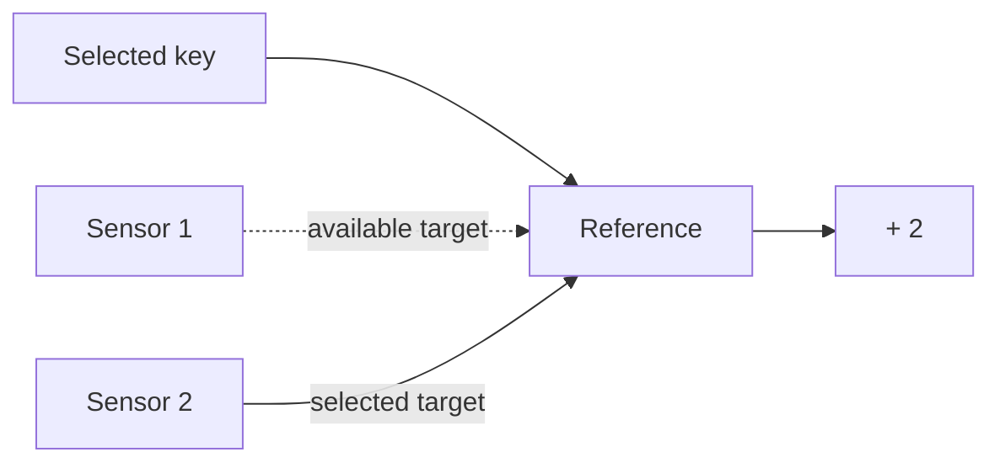

# References and dynamic binding

A time series reference identifies another time series. It allows a consumer to
follow a selected source without copying each target value into a new source.

## Selecting a changing source

A changing dictionary key selects the source to follow. Target updates then reach
the calculation even when the key does not change.

<!-- runnable-example -->
::::::{tab-set}
:sync-group: language

:::::{tab-item} Python
:sync: python

```python
from bg import REMOVE, TS, TSD, graph, run_graph

@graph
def selected(readings: TSD[int, TS[int]], sensor: int) -> int:
    return readings[sensor] + 2

print(run_graph(selected, [{1: 18, 2: 30}, {1: 19}, {2: 31}, {2: REMOVE}], [1, 2, None, None]))
```

Output:

```text
[20, 32, 33, None]
```
:::::

:::::{tab-item} C++
:sync: cpp

::::{tab-set}

:::{tab-item} Code

```cpp
#include <bg/library.hpp>
#include <bg/node.hpp>
#include <bg/run_graph.hpp>
#include <iostream>
#include <bg/time_series/tsd/tsd_type.hpp>

using namespace bg;
using namespace bg::operators;
using namespace literal;

auto selected(wp<TSD<i64, TS<i64>>> readings, wp<TS<i64>> sensor) {
    return readings[sensor] + 2;
}

int main() {
    const auto result = run_graph(selected,
        {{{1, 18}, {2, 30}}, {{1, 19}}, {{2, 31}}, {{2, REMOVE}}}, {1, 2, SKIP, SKIP});
    std::cout << result << '\n';
}
```

Output:

```text
[20, 32, 33, None]
```
:::

:::{tab-item} Build and run

The [C++ example project](../installation.md#c-example-project) builds this code as `main.cpp`.

```sh
cmake -S . -B build -DCMAKE_PREFIX_PATH=/path/to/bg/install
cmake --build build --config Release
```

Run `./build/example` on Linux or macOS, or `build/Release/example.exe` on Windows.
:::
::::
:::::
::::::

| Position | Selected sensor | Result |
| --- | --- | --- |
| 1 | 1 | Sensor 1 value 18 + 2 = 20 |
| 2 | 2 | Sensor 2 current value 30 + 2 = 32 |
| 3 | 2 | Sensor 2 update 31 + 2 = 33 |
| 4 | 2 | Sensor 2 removed; result becomes invalid |

## Source identity and value updates

`REF[TS[int]]` or `REF<TS<i64>>` declares a reference to an integer time series.
The reference's value identifies its target. Retargeting and target value changes
are separate events.



An ordinary value input follows the target automatically. An explicitly declared
reference input observes the reference itself. `if_then_else`, dictionary selection,
`map`, and `switch_` use references to connect selected or inner outputs.

## Invalid and removed targets

An existing target can become invalid without changing reference identity. A removed
item no longer provides a valid value. Re-adding the selected key permits the value
connection to recover.

Consumers must check the validity of the value they read. A reference object alone
does not establish target validity. Callback views must not be retained after their
callback. [Reference contracts](../../reference/types.md#references) specify binding
and lifetime requirements.
