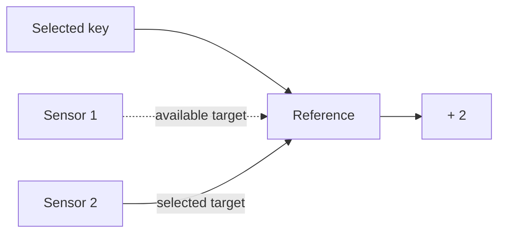

# References and dynamic binding

If a calculation needs to follow a selected source as that source changes, use a
time series reference. It identifies another time series, allowing the consumer to
follow its updates without copying each target value into a new source.

## Selecting a changing source

To follow one item from a changing dictionary, select it with a changing key.
The result follows that item's source, so later target updates reach the calculation
even while the selected key stays the same.

<!-- runnable-example -->
::::::{tab-set}
:sync-group: language

:::::{tab-item} Python
:sync: python

```python
from hgraph import REMOVE, TS, TSD, graph, run_graph

@graph
def selected(readings: TSD[int, TS[int]], sensor: int) -> int:
    return readings[sensor] + 2

print(run_graph(selected, [{1: 18, 2: 30}, {1: 19}, {2: 31}, {2: REMOVE}], [1, 2, None, None]))
```

Output:

```text
[20, 32, 33, None]
```
:::::

:::::{tab-item} C++
:sync: cpp

::::{tab-set}

:::{tab-item} Code

```cpp
#include <hg/library.hpp>
#include <hg/node.hpp>
#include <hg/run_graph.hpp>
#include <iostream>
#include <hg/time_series/tsd/tsd_type.hpp>

using namespace hg;
using namespace hg::operators;
using namespace literal;

auto selected(wp<TSD<i64, TS<i64>>> readings, wp<TS<i64>> sensor) {
    return readings[sensor] + 2;
}

int main() {
    const auto result = run_graph(selected,
        {{{1, 18}, {2, 30}}, {{1, 19}}, {{2, 31}}, {{2, REMOVE}}}, {1, 2, SKIP, SKIP});
    std::cout << result << '\n';
}
```

Output:

```text
[20, 32, 33, None]
```
:::

:::{tab-item} Build and run

The [C++ example project](../installation.md#c-example-project) builds this code as `main.cpp`.

```sh
cmake -S . -B build -DCMAKE_PREFIX_PATH="/path/to/site-packages"
cmake --build build --config Release
```

Run `./build/example` on Linux or macOS, or `build/Release/example.exe` on Windows.
:::
::::
:::::
::::::

| Position | Selected sensor | Result |
| --- | --- | --- |
| 1 | 1 | Sensor 1 value 18 + 2 = 20 |
| 2 | 2 | Sensor 2 current value 30 + 2 = 32 |
| 3 | 2 | Sensor 2 update 31 + 2 = 33 |
| 4 | 2 | Sensor 2 removed; result becomes invalid |

## Source identity and value updates

If a node needs to inspect which source is selected, declare a reference input such
as `REF[TS[int]]` or `REF<TS<i64>>`. An ordinary value input follows the target
automatically, while the explicit reference exposes source identity separately
from changes to the target's value.



`if_then_else`, dictionary selection, `map`, and `switch_` use references to connect
selected or inner outputs.

## Invalid and removed targets

When following a selected item, check the target's availability before reading its
value. The target can become invalid without changing reference identity, and a
removed item no longer supplies a valid value. Re-adding the selected key allows
the value connection to recover.

A reference object alone does not establish target validity, and its callback views
must not be retained after the callback. The [reference contracts](../../reference/types.md#references)
specify binding and lifetime requirements.
