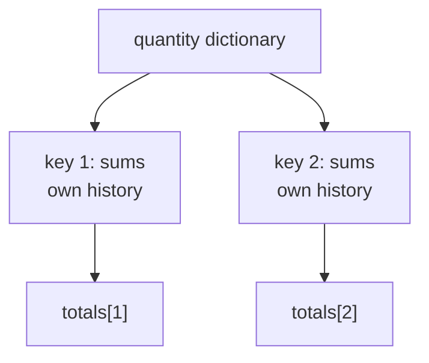

# Per-sensor running totals

To accumulate quantities independently for a changing set of sensors, map a
running-total graph over a dictionary. Each key owns a graph instance and its
accumulator. Removing a key ends that accumulation; adding the key again
starts a new total.

Prerequisites: [Dictionaries](../guide/advanced-graphs/collections.md#dictionaries),
[running calculations](../guide/graphs/aggregation.md#running-totals-and-means), [map](../guide/graphs/iteration.md#per-key-calculations-with-map).

<!-- runnable-example -->
::::::{tab-set}
:sync-group: language

:::::{tab-item} Python
:sync: python

```python
from bg import REMOVE, TS, TSD, graph, map, run_graph
from bg.operators import sums

@graph
def accumulated_quantity(quantity: int) -> int:
    return sums(quantity)

@graph
def sensor_one_total(quantities: TSD[int, TS[int]]) -> int:
    totals = map(accumulated_quantity, quantities)
    return totals[1]

print(run_graph(sensor_one_total, [
    {1: 3, 2: 10},
    {1: 4, 2: 5},
    {2: 2},
    {1: REMOVE},
    {1: 6},
    {1: 1},
]))
```

Output:

```text
[3, 7, None, None, 6, 7]
```
:::::

:::::{tab-item} C++
:sync: cpp

::::{tab-set}

:::{tab-item} Code

```cpp
#include <bg/library.hpp>
#include <bg/run_graph.hpp>
#include <bg/graph.hpp>
#include <bg/map.hpp>
#include <bg/time_series/tsd/tsd_type.hpp>
#include <iostream>

using namespace bg;
using namespace bg::operators;
using namespace literal;

auto accumulated_quantity(wp<TS<i64>> quantity) {
    return sums(quantity).as<TS<i64>>();
}

auto sensor_one_total(wp<TSD<i64, TS<i64>>> quantities) {
    const auto totals = map(accumulated_quantity, quantities);
    return totals[i64{1}].as<TS<i64>>();
}

int main() {
    const auto result = run_graph(graph(sensor_one_total), {
        {{1, 3}, {2, 10}}, {{1, 4}, {2, 5}}, {{2, 2}},
        {{1, REMOVE}}, {{1, 6}}, {{1, 1}}});
    std::cout << result << '\n';
}
```

Output:

```text
[3, 7, None, None, 6, 7]
```
:::

:::{tab-item} Build and run

The [C++ example project](../guide/installation.md#c-example-project)
builds this example as `main.cpp`, linked to `bg::library`.
:::
::::
:::::
::::::

The result selects sensor 1 so its lifecycle is visible. Sensor 2's updates
continue its own total without publishing an update to the selected result.

| Step | Sensor 1 update | Sensor 1 total | Sensor 2 total |
| --- | --- | --- | --- |
| 1 | 3 | 3 | 10 |
| 2 | 4 | 7 | 15 |
| 3 | No update | 7 | 17 |
| 4 | Remove | No instance | 17 |
| 5 | 6 | 6 | 17 |
| 6 | 1 | 7 | 17 |



Removal invalidates the selected result. Python's recorded `None` represents
both no publication and invalidation; the C++ literal check distinguishes
`SKIP` at step 3 from `INVALID` at step 4. See
[test result encoding](../reference/testing.md).

`map` returns the complete dictionary of totals; selecting `[1]` is specific
to this example. Applying `sum_` directly to the input dictionary would instead
sum the current quantities across sensors. It would not accumulate each
sensor's events. See [aggregation and history](../guide/graphs/aggregation.md).

C++ supplies concrete output types with `.as<TS<i64>>()` at the branch and
selected-result boundaries, as required by [map](../guide/graphs/iteration.md#per-key-calculations-with-map).
[Download the examples](examples.md) includes the complete projects.
