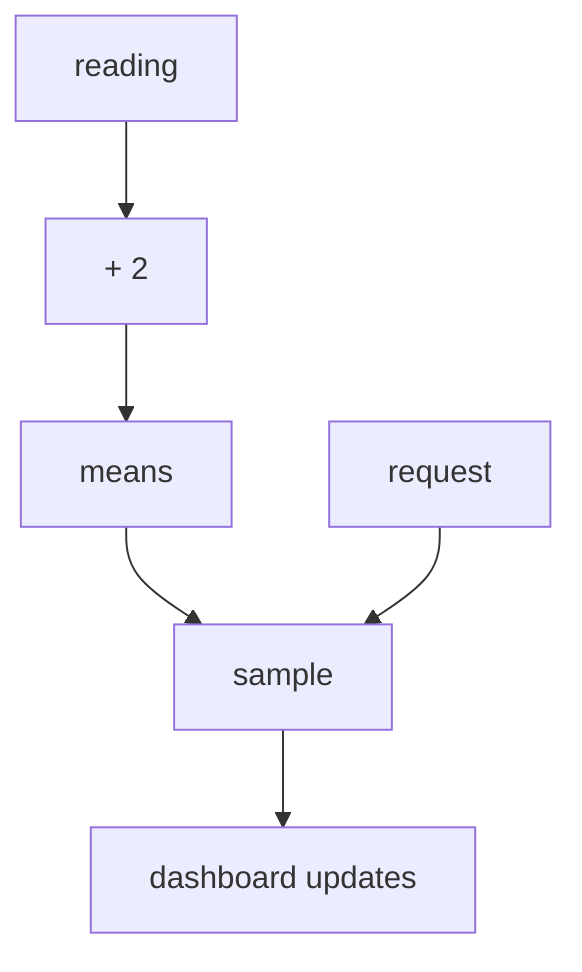

# Running summaries on request

To refresh a dashboard only when requested while retaining every sensor reading
in its statistics, calculate the running mean before sampling it. Reading
updates maintain the mean; request updates publish its current value.

Prerequisites: [Sampling](../guide/graphs/updates.md#signal-driven-publication),
[running calculations](../guide/graphs/aggregation.md#running-totals-and-means).

<!-- runnable-example -->
::::::{tab-set}
:sync-group: language

:::::{tab-item} Python
:sync: python

```python
from bg import graph, run_graph
from bg.operators import means, sample

@graph
def requested_average(reading: int, request: bool) -> float:
    calibrated = reading + 2
    average = means(calibrated)
    return sample(request, average)

print(run_graph(
    requested_average,
    [18, 20, 22, None, 24, None],
    [None, True, None, True, True, False],
))
```

Output:

```text
[None, 21.0, None, 22.0, 23.0, 23.0]
```
:::::

:::::{tab-item} C++
:sync: cpp

::::{tab-set}

:::{tab-item} Code

```cpp
#include <bg/library.hpp>
#include <bg/run_graph.hpp>
#include <iostream>

using namespace bg;
using namespace bg::operators;
using namespace literal;

auto requested_average(wp<TS<i64>> reading, wp<TS<bool>> request) {
    const auto calibrated = reading + 2;
    const auto average = means(calibrated);
    return sample(request, average);
}

int main() {
    const auto result = run_graph(
        requested_average,
        {18, 20, 22, SKIP, 24, SKIP},
        {SKIP, true, SKIP, true, true, false});
    std::cout << result << '\n';
}
```

Output:

```text
[None, 21, None, 22, 23, 23]
```
:::

:::{tab-item} Build and run

The [C++ example project](../guide/installation.md#c-example-project)
builds this example as `main.cpp`, linked to `bg::library`.
:::
::::
:::::
::::::

| Step | Calibrated reading update | Current mean | Request update | Output update |
| --- | --- | --- | --- | --- |
| 1 | 20 | 20.0 | No update | No update |
| 2 | 22 | 21.0 | True | 21.0 |
| 3 | 24 | 22.0 | No update | No update |
| 4 | No update | 22.0 | True | 22.0 |
| 5 | 26 | 23.0 | True | 23.0 |
| 6 | No update | 23.0 | False | 23.0 |

The third reading contributes even though no request arrives at step 3. A
request at step 4 publishes the updated mean. Simultaneous reading and request
updates at step 5 use the new reading. Each request update triggers sampling,
including the false value at step 6.



Placing `sample` before `means` would instead average the requested samples.
Adding `dedup` after sampling would suppress repeated summaries, including the
last output here. These orders serve different application requirements; see
[changing-input patterns](../guide/graphs/updates.md).

For a continuously published alarm, see [alarm changes](temperature-monitor.md).
[Download the examples](examples.md) includes both language versions.
