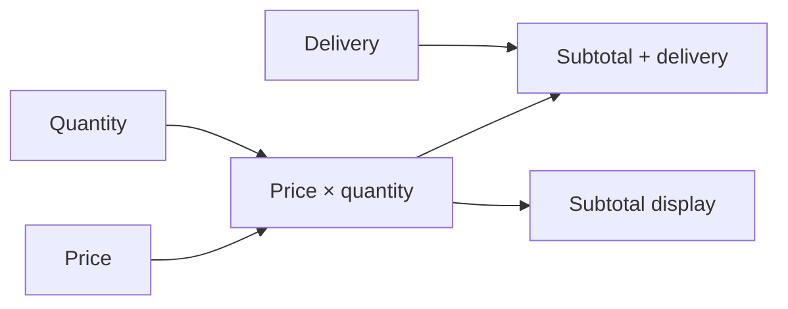

# HG documentation

If your application needs to keep derived prices, sensor readings, or running
statistics up to date, HG lets you describe the calculations and how they depend on
one another. As inputs change, the graph updates the affected results without your
application having to call each calculation in the right order.

Each node retains its current result, so several consumers can share an intermediate
calculation without repeating its work. The graph below uses one subtotal for both
a displayed value and the order total.



The multiplication is a **node**, and its incoming connections identify the price
and quantity it depends on.

The functions below express the same arithmetic in ordinary code and graph code:
`order_total` computes a value directly, while `order_graph` connects a fixed price
to multiplication and addition nodes. Calling `run_graph` evaluates those nodes and
captures their output.

<!-- runnable-example -->
::::::{tab-set}
:sync-group: language

:::::{tab-item} Python
:sync: python

```python
from hgraph import graph, run_graph
from hgraph.operators import const_


def order_total(price: int, quantity: int, delivery: int) -> int:
    return price * quantity + delivery


@graph
def order_graph() -> int:
    price = const_(5)
    return price * 3 + 2


print(order_total(5, 3, 2))
print(run_graph(order_graph))
```

Output:

```text
17
[17]
```
:::::

:::::{tab-item} C++
:sync: cpp

::::{tab-set}

:::{tab-item} Code

```cpp
#include <hg/library.hpp>
#include <hg/run_graph.hpp>

#include <iostream>

using namespace hg;
using namespace hg::operators;

auto order_total(int price, int quantity, int delivery) {
    return price * quantity + delivery;
}

auto order_graph() {
    const auto price = const_(5);
    return price * 3 + 2;
}

int main() {
    std::cout << order_total(5, 3, 2) << '\n';
    std::cout << run_graph(order_graph) << '\n';
}
```

Output:

```text
17
[17]
```
:::

:::{tab-item} Build and run

The [C++ example project](guide/installation.md#c-example-project) builds this code as `main.cpp`.

```sh
cmake -S . -B build -DCMAKE_PREFIX_PATH="/path/to/site-packages"
cmake --build build --config Release
```

Run `./build/example` on Linux or macOS, or `build/Release/example.exe` on Windows.
:::
::::
:::::
::::::

The ordinary call returns `17`, while `[17]` contains the graph's captured output
update. This example uses a fixed input; with [changing inputs](guide/graphs/updates.md),
the same connections maintain the result across successive values. A graph function
constructs the connections once per graph instance, and node code calculates their
values during evaluation.

::::{grid} 1 2 2 2
:gutter: 3

:::{grid-item-card} Basic syntax
:link: guide/getting-started
:link-type: doc

A compact introduction with runnable Python and C++ examples.
:::
:::{grid-item-card} Writing graphs
:link: guide/graphs/composition
:link-type: doc

Composition, types, collections, conditionals, iteration, and aggregation.
:::
:::{grid-item-card} Writing nodes
:link: guide/nodes/calculations
:link-type: doc

Calculations implemented with ordinary Python or C++ values.
:::
:::{grid-item-card} Advanced syntax
:link: guide/advanced-syntax
:link-type: doc

Time series declarations, input views, state, and update controls.
:::
:::{grid-item-card} Library operators
:link: reference/library-index
:link-type: doc

Selection, running calculations, timing, collections, and text.
:::
:::{grid-item-card} Extensions
:link: extensions/index
:link-type: doc

HTTP services, WebSocket connections, nullable columns, and tables.
:::
::::

Examples assume basic knowledge of Python or C++. Language tabs retain the selected
language across pages. C++ build commands are in the **Build and run** tab.

```{toctree}
:caption: Getting started
:hidden:

guide/installation
guide/getting-started
```

```{toctree}
:caption: Writing graphs
:hidden:

guide/graphs/composition
guide/graphs/types
guide/graphs/scalars
guide/graphs/updates
guide/graphs/conditionals
guide/graphs/iteration
guide/graphs/aggregation
```

```{toctree}
:caption: Writing nodes
:hidden:

guide/nodes/calculations
guide/nodes/results
```

```{toctree}
:caption: Advanced graphs
:hidden:

guide/advanced-syntax
guide/advanced-graphs/types
guide/advanced-graphs/collections
guide/advanced-graphs/references
guide/advanced-graphs/dependencies
guide/advanced-graphs/guarantees
guide/advanced-graphs/sharing
```

```{toctree}
:caption: Advanced nodes
:hidden:

guide/advanced-nodes/inputs
guide/advanced-nodes/collections
guide/advanced-nodes/state
guide/advanced-nodes/scheduling
```

```{toctree}
:caption: Execution and diagnostics
:hidden:

guide/execution/running
guide/execution/time
how-to/testing
how-to/errors
how-to/profiling
how-to/cpp-extension
how-to/examples
how-to/temperature-monitor
how-to/requested-summary
how-to/per-sensor-totals
```

```{toctree}
:caption: Extensions
:hidden:

extensions/index
extensions/web
extensions/web-auth
extensions/websocket
extensions/frame
extensions/frame-expressions
extensions/frame-nodes
```

```{toctree}
:caption: API reference
:hidden:

reference/index
reference/graph-code
reference/nodes
reference/input-views
reference/outputs
reference/types
reference/scalars
reference/literals
reference/testing
reference/execution
reference/state
reference/sources
reference/higher-order
reference/services
reference/operators
```

```{toctree}
:caption: Library reference
:hidden:

reference/library-index
reference/library-numeric
reference/library-selection
reference/library-stateful
reference/library-time
reference/library-collections
reference/library-text
```
