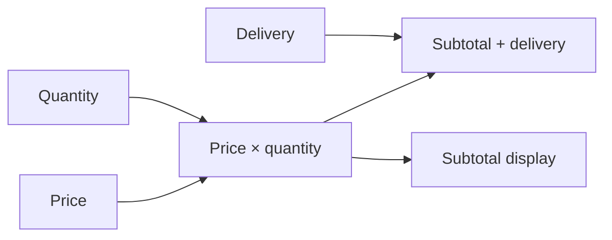

# BG documentation

BG connects calculations whose inputs change over time. Each node retains its
current result. BG tracks the connections between nodes and evaluates affected
calculations when an input updates. Shared intermediate results can feed several
outputs without repeating the calculation.

This supports derived prices, sensor processing, running statistics, and
calculations maintained independently for many items.



The multiplication is a **node**. Its connections define its dependencies.
The subtotal remains available to both consumers until it updates again.
A **graph function** constructs these connections; node code computes their values.


<!-- runnable-example -->
::::::{tab-set}
:sync-group: language

:::::{tab-item} Python
:sync: python

```python
from bg import graph, run_graph
from bg.operators import const_

@graph
def subtotal(price: int, quantity: int) -> int:
    return price * quantity

@graph
def total() -> int:
    return subtotal(const_(5), 3) + 2

print(run_graph(total))
```

Output:

```text
[17]
```
:::::

:::::{tab-item} C++
:sync: cpp

::::{tab-set}

:::{tab-item} Code

```cpp
#include <bg/library.hpp>
#include <bg/node.hpp>
#include <bg/run_graph.hpp>
#include <iostream>

using namespace bg;
using namespace bg::operators;
using namespace literal;

auto subtotal(wp<TS<i64>> price, int quantity) {
    return price * quantity;
}

auto total() {
    return subtotal(const_(5).as<TS<i64>>(), 3) + 2;
}

int main() {
    const auto result = run_graph(total);
    std::cout << result << '\n';
}
```

Output:

```text
[17]
```
:::

:::{tab-item} Build and run

The [C++ example project](guide/installation.md#c-example-project) builds this code as `main.cpp`.

```sh
cmake -S . -B build -DCMAKE_PREFIX_PATH=/path/to/bg/install
cmake --build build --config Release
```

Run `./build/example` on Linux or macOS, or `build/Release/example.exe` on Windows.
:::
::::
:::::
::::::

The example has a fixed result. [Changing inputs](guide/graphs/updates.md) use the
same connections with successive values. BG retains current values; history is
provided by operations such as running totals and lag.

::::{grid} 1 2 2 2
:gutter: 3

:::{grid-item-card} Basic syntax
:link: guide/getting-started
:link-type: doc

A compact introduction with runnable Python and C++ examples.
:::
:::{grid-item-card} Writing graphs
:link: guide/graphs/composition
:link-type: doc

Composition, types, collections, conditionals, iteration, and aggregation.
:::
:::{grid-item-card} Writing nodes
:link: guide/nodes/calculations
:link-type: doc

Calculations implemented with ordinary Python or C++ values.
:::
:::{grid-item-card} Advanced syntax
:link: guide/advanced-syntax
:link-type: doc

Time series declarations, input views, state, and update controls.
:::
::::

Examples assume basic knowledge of Python or C++. Language tabs retain the selected
language across pages. C++ build commands are in the **Build and run** tab.

```{toctree}
:caption: Getting started
:hidden:

guide/installation
guide/getting-started
```

```{toctree}
:caption: Writing graphs
:hidden:

guide/graphs/composition
guide/graphs/types
guide/graphs/scalars
guide/graphs/updates
guide/graphs/conditionals
guide/graphs/iteration
guide/graphs/aggregation
```

```{toctree}
:caption: Writing nodes
:hidden:

guide/nodes/calculations
guide/nodes/results
```

```{toctree}
:caption: Advanced graphs
:hidden:

guide/advanced-syntax
guide/advanced-graphs/types
guide/advanced-graphs/collections
guide/advanced-graphs/references
guide/advanced-graphs/dependencies
guide/advanced-graphs/guarantees
guide/advanced-graphs/sharing
```

```{toctree}
:caption: Advanced nodes
:hidden:

guide/advanced-nodes/inputs
guide/advanced-nodes/collections
guide/advanced-nodes/state
guide/advanced-nodes/scheduling
```

```{toctree}
:caption: Execution and diagnostics
:hidden:

guide/execution/running
guide/execution/time
how-to/testing
how-to/errors
how-to/profiling
how-to/cpp-extension
how-to/examples
how-to/temperature-monitor
how-to/requested-summary
how-to/per-sensor-totals
```

```{toctree}
:caption: API reference
:hidden:

reference/index
reference/graph-code
reference/nodes
reference/input-views
reference/outputs
reference/types
reference/scalars
reference/literals
reference/testing
reference/execution
reference/state
reference/sources
reference/higher-order
reference/services
reference/operators
```

```{toctree}
:caption: Library reference
:hidden:

reference/library-index
reference/library-numeric
reference/library-selection
reference/library-stateful
reference/library-time
reference/library-collections
reference/library-text
```
