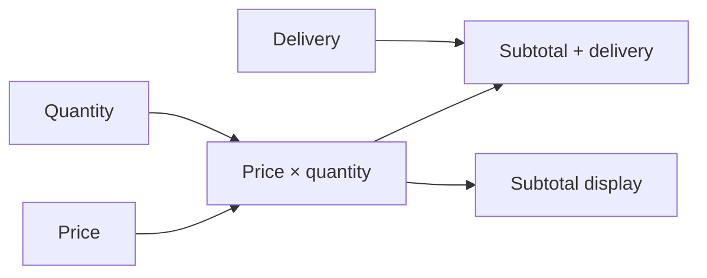

# HG documentation

HG maintains calculations whose inputs change over time. Use it for derived prices,
sensor processing, running statistics, or independent calculations for many items.

A graph records the dependencies between calculations. HG evaluates affected nodes
when an input updates and retains their current results. Several consumers can share
an intermediate result without repeating its calculation.



The multiplication is a **node**. Its connections define its dependencies.
The subtotal remains available to both consumers until it updates again.

The two functions below express the same arithmetic. `order_total` computes the value
directly. `order_graph` connects a fixed price to multiplication and addition nodes;
`run_graph` evaluates those nodes and captures the result.

<!-- runnable-example -->
::::::{tab-set}
:sync-group: language

:::::{tab-item} Python
:sync: python

```python
from hgraph import graph, run_graph
from hgraph.operators import const_


def order_total(price: int, quantity: int, delivery: int) -> int:
    return price * quantity + delivery


@graph
def order_graph() -> int:
    price = const_(5)
    return price * 3 + 2


print(order_total(5, 3, 2))
print(run_graph(order_graph))
```

Output:

```text
17
[17]
```
:::::

:::::{tab-item} C++
:sync: cpp

::::{tab-set}

:::{tab-item} Code

```cpp
#include <hg/library.hpp>
#include <hg/run_graph.hpp>

#include <iostream>

using namespace hg;
using namespace hg::operators;

auto order_total(int price, int quantity, int delivery) {
    return price * quantity + delivery;
}

auto order_graph() {
    const auto price = const_(5);
    return price * 3 + 2;
}

int main() {
    std::cout << order_total(5, 3, 2) << '\n';
    std::cout << run_graph(order_graph) << '\n';
}
```

Output:

```text
17
[17]
```
:::

:::{tab-item} Build and run

The [C++ example project](guide/installation.md#c-example-project) builds this code as `main.cpp`.

```sh
cmake -S . -B build -DCMAKE_PREFIX_PATH="/path/to/site-packages"
cmake --build build --config Release
```

Run `./build/example` on Linux or macOS, or `build/Release/example.exe` on Windows.
:::
::::
:::::
::::::

`17` is an ordinary value. `[17]` is the sequence of captured graph output updates.
The fixed input keeps the first example small. With
[changing inputs](guide/graphs/updates.md), HG retains the current inputs and evaluates
affected nodes in dependency order; application code does not need to call each
dependent calculation. Graph functions construct those connections once per graph
instance. Node code performs the calculations during evaluation.

::::{grid} 1 2 2 2
:gutter: 3

:::{grid-item-card} Basic syntax
:link: guide/getting-started
:link-type: doc

A compact introduction with runnable Python and C++ examples.
:::
:::{grid-item-card} Writing graphs
:link: guide/graphs/composition
:link-type: doc

Composition, types, collections, conditionals, iteration, and aggregation.
:::
:::{grid-item-card} Writing nodes
:link: guide/nodes/calculations
:link-type: doc

Calculations implemented with ordinary Python or C++ values.
:::
:::{grid-item-card} Advanced syntax
:link: guide/advanced-syntax
:link-type: doc

Time series declarations, input views, state, and update controls.
:::
:::{grid-item-card} Library operators
:link: reference/library-index
:link-type: doc

Selection, running calculations, timing, collections, and text.
:::
:::{grid-item-card} Extensions
:link: extensions/index
:link-type: doc

HTTP services, WebSocket connections, nullable columns, and tables.
:::
::::

Examples assume basic knowledge of Python or C++. Language tabs retain the selected
language across pages. C++ build commands are in the **Build and run** tab.

```{toctree}
:caption: Getting started
:hidden:

guide/installation
guide/getting-started
```

```{toctree}
:caption: Writing graphs
:hidden:

guide/graphs/composition
guide/graphs/types
guide/graphs/scalars
guide/graphs/updates
guide/graphs/conditionals
guide/graphs/iteration
guide/graphs/aggregation
```

```{toctree}
:caption: Writing nodes
:hidden:

guide/nodes/calculations
guide/nodes/results
```

```{toctree}
:caption: Advanced graphs
:hidden:

guide/advanced-syntax
guide/advanced-graphs/types
guide/advanced-graphs/collections
guide/advanced-graphs/references
guide/advanced-graphs/dependencies
guide/advanced-graphs/guarantees
guide/advanced-graphs/sharing
```

```{toctree}
:caption: Advanced nodes
:hidden:

guide/advanced-nodes/inputs
guide/advanced-nodes/collections
guide/advanced-nodes/state
guide/advanced-nodes/scheduling
```

```{toctree}
:caption: Execution and diagnostics
:hidden:

guide/execution/running
guide/execution/time
how-to/testing
how-to/errors
how-to/profiling
how-to/cpp-extension
how-to/examples
how-to/temperature-monitor
how-to/requested-summary
how-to/per-sensor-totals
```

```{toctree}
:caption: Extensions
:hidden:

extensions/index
extensions/web
extensions/web-auth
extensions/websocket
extensions/frame
extensions/frame-expressions
extensions/frame-nodes
```

```{toctree}
:caption: API reference
:hidden:

reference/index
reference/graph-code
reference/nodes
reference/input-views
reference/outputs
reference/types
reference/scalars
reference/literals
reference/testing
reference/execution
reference/state
reference/sources
reference/higher-order
reference/services
reference/operators
```

```{toctree}
:caption: Library reference
:hidden:

reference/library-index
reference/library-numeric
reference/library-selection
reference/library-stateful
reference/library-time
reference/library-collections
reference/library-text
```
